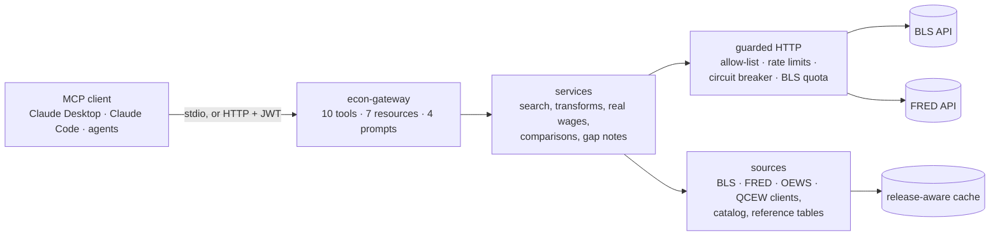

# Economics Data Gateway

<!-- mcp-name: io.github.Eklavya17/econ-gateway -->

An MCP server that gives any AI assistant **live, official, cited** U.S. economic data from the
Bureau of Labor Statistics (BLS) and the Federal Reserve's FRED service: jobs, unemployment,
wages by occupation and place, inflation, job openings, jobless claims, GDP and interest rates,
nationally and for states, metro areas and counties.

> **Q:** What did wages look like for registered nurses in Texas last year?
>
> **A:** For registered nurses in Texas in May 2025, the annual median wage was $95,970, with an
> annual mean wage of $95,380. The hourly median wage was $46.14 [...]
> Source: https://www.bls.gov/oes/current/oes291141.htm
>
> *3 tool calls: `find_occupation` → `find_area` → `get_occupation_wages`. Full transcript and
> three more questions in [docs/DEMO.md](docs/DEMO.md).*

- **Works with any MCP client:** Claude Desktop, Claude Code, Cursor or your own agent, over stdio
  or Streamable HTTP with JWT auth.
- **Numbers only from official data.** Every value carries its period, its seasonal adjustment and
  a link to cite. Gaps the agencies never published are reported as gaps, never filled in.
- **Measured.** In 22 realistic questions graded against live answers, a model using the gateway
  got **22/22** right; the same model without it got **2/22** ([evaluation](#evaluation)).

The gateway is self-contained: one repository, one install, one Docker image. It is Project 2
of a series; how it differs from Project 1 is [below](#how-this-differs-from-project-1).

## Quick start

Requires Python 3.11+ and [uv](https://docs.astral.sh/uv/) (or plain `pip`).

```bash
git clone https://github.com/Eklavya17/Economics-Data-Gateway.git
```

```bash
cd Economics-Data-Gateway
```

```bash
uv venv --python 3.13 .venv
```

```bash
uv pip install --python .venv -e ".[dev]"
```

Copy `.env.example` to `.env` and add your keys:

| Key | Needed for | Get one (free) |
|---|---|---|
| `FRED_API_KEY` | FRED series and search (state wages, claims, rates, GDP) and the release calendar | https://fred.stlouisfed.org/docs/api/api_key.html |
| `BLS_API_KEY` | Optional: raises BLS limits from 25 to 500 queries a day | https://data.bls.gov/registrationEngine/ |
| `BLS_USER_AGENT` | Recommended: bls.gov refuses anonymous downloads of OEWS files | e.g. `EconGateway/1.0 (you@example.com)` |

Check that everything works (offline tests, then one live call over stdio):

```bash
.venv/Scripts/python -m pytest
```

```bash
.venv/Scripts/python scripts/smoke_live.py
```

On macOS and Linux, use `.venv/bin/` wherever these instructions say `.venv/Scripts/`.

**Connect Claude Code** (from the repository folder):

```bash
claude mcp add econ-gateway -- "$PWD/.venv/Scripts/econ-gateway.exe"
```

**Connect Claude Desktop:** add this to `claude_desktop_config.json` (Settings → Developer → Edit
Config) with the absolute path to your clone, then restart the app:

```json
{
  "mcpServers": {
    "econ-gateway": {
      "command": "C:\\path\\to\\Economics-Data-Gateway\\.venv\\Scripts\\econ-gateway.exe"
    }
  }
}
```

**Over HTTP or Docker:** see [docs/DEPLOYMENT.md](docs/DEPLOYMENT.md).

## What you can ask

- "What's the unemployment rate in the Austin metro area?"
- "Which U.S. metro pays registered nurses the most?"
- "Have manufacturing wages kept up with inflation since 2019?"
- "Rank pay growth across industries against CPI."
- "How is the job market in Travis County, Texas?"
- "When is the next CPI release?"

## How it works



- **Discovery:** the model finds series IDs, area IDs and occupation codes through tools
  (`search_series`, `find_area`, `find_occupation`); it never has to guess one.
- **Data:** values, histories, year-over-year changes, real wages and rankings are computed on
  the server, so the model quotes numbers instead of doing arithmetic.
- **Reliability:**
  - cached data stays valid until the agency's next scheduled release;
  - outages fall back to the last cached copy, labelled with its age;
  - every request goes through rate limits and a circuit breaker, and the BLS daily quota is
    tracked.

## Tools

Generated from the server's own definitions; full parameters and return fields are in
[docs/TOOLS.md](docs/TOOLS.md), and sample responses in [docs/EXAMPLES.md](docs/EXAMPLES.md).

<!-- tools:start (generated by scripts/gen_tool_docs.py; do not edit by hand) -->
| Toolset | Tool | What it does | Inputs (* required) |
|---|---|---|---|
| core | `search_series` | Find official BLS/FRED series IDs for a topic and place. Start here. | `query`*, `geography`, `limit` |
| core | `describe_series` | Explain exactly what a series measures: title, units, frequency, coverage and notes. | `series_id`* |
| core | `find_area` | Turn a place name into an area_id and its local unemployment series IDs. | `query`*, `level`, `limit` |
| core | `get_latest` | Get the most recent published value of each series, with standard comparisons. | `series_ids`* |
| core | `get_series` | Get historical observations for one or more series, optionally transformed. | `series_ids`*, `start_date`, `end_date`, `transform`, `max_points`, `response_format` |
| wages | `find_occupation` | Find Standard Occupational Classification (SOC) codes for a job title. | `query`*, `limit` |
| wages | `get_occupation_wages` | Get official employment and wages for occupations by state or metro (BLS OEWS). | `occupation_codes`*, `area_ids`, `rank_across`, `sort_by`, `limit`, `year`, `response_format` |
| regional | `get_area_employment` | Get jobs, establishments and average weekly wages for counties, metros or states. | `area_ids`*, `industries`, `year`, `quarter` |
| compute | `real_wage_growth` | Are wages keeping up with inflation? Inflation-adjusted growth of a wage series. | `wage_series_id`*, `deflator`, `start_date`, `end_date`, `max_points` |
| compute | `compare_series` | Rank several series on one measure, optionally against a benchmark such as CPI. | `series_ids`*, `measure`*, `since`, `benchmark_series_id` |
<!-- tools:end -->

Every tool is read-only and returns structured JSON with an output schema. Responses are kept
small: 60 points per series by default, 1,200 per call, and `truncated: true` with a hint whenever
data was cut.

## Resources and prompts

**Resources** are documents a client attaches as context (in Claude Code, type `@` and pick an
`econ://` resource). **Prompts** are question templates, which Claude Code shows as slash
commands such as `/mcp__econ-gateway__occupation_wages`. Numbers still come from the tools.

<!-- reference:start (generated by scripts/gen_tool_docs.py; do not edit by hand) -->
| Resource | What it holds |
|---|---|
| `econ://catalog` | Every series in the gateway's curated, validated catalog (~300 series, ~15K tokens). |
| `econ://releases` | Last and next release dates of the headline BLS and BEA releases. |
| `econ://methodology` | Index of methodology notes: seasonal adjustment, revisions, OEWS, QCEW, LAUS, etc. |
| `econ://status` | Gateway version, mounted toolsets, whether API keys are configured, upstream health. |
| `econ://catalog/{category}` | The catalog series in one category: unemployment, wages, inflation, employment, etc. |
| `econ://series/{series_id}` | One series: metadata, coverage, release schedule and latest value. |
| `econ://methodology/{topic}` | One methodology note, e.g. econ://methodology/rates-and-changes. |

| Prompt | What it asks | Arguments (* required) |
|---|---|---|
| `occupation_wages` | What an occupation earns in a state or metro area (OEWS), with the U.S. median. | `occupation`*, `place` |
| `labor_market_snapshot` | Current state of the labor market: unemployment, jobs, pay, inflation, claims. | `place` |
| `local_economy` | Jobs, pay by industry and unemployment for a county, metro area or state (QCEW). | `place`* |
| `real_wage_check` | Are wages keeping up with inflation? Real wage growth for one pay measure. | `wage_measure`, `deflator`, `since` |
<!-- reference:end -->

## Data rules

The responses enforce what a careful analyst would:
- **Rates change in percentage points.** For series in percent, percent-change fields are
  deliberately `null`.
- **"Year ago" means the same calendar period.** Weekly data snaps to the nearest week.
- **Unpublished periods are named, not filled.** BLS never published October 2025
  household-survey or CPI data (federal shutdown). Responses say so and give the nearest published
  months, so a comparison is never mislabelled.
- **Pay above the OEWS cap is never invented.** Those values are reported as `top_coded`.
- **Suppressed QCEW cells are not zeros.** They come back as `disclosed: false`.
- **Real wages use the exact formula**, (1 + wage growth) / (1 + inflation) − 1, with a price
  index that matches the wage series' seasonal adjustment and frequency.
- **Comparisons use the same months.** Against a benchmark such as CPI, every series is measured
  at the benchmark's latest period.
- **Newer data is never hidden.** Each series reports its latest available period, and a note says
  when a requested end date cut newer data off.

Background on each topic is in the `econ://methodology` notes
([source](src/econ_gateway/methodology/)).

## Evaluation

A reference client runs 22 realistic questions through the gateway with an LLM. Each is graded
against an answer computed live from official data by code that does not share the gateway's
services. The same questions also run with no tools.

| Model `gpt-4.1-mini`, 2026-11-08 | Dev (14) | Held-out (8) | Tool calls / answer | Tool errors |
|---|---|---|---|---|
| With the gateway | **14/14** | **8/8** | 2.1–2.4 | 0 |
| Without it | 1/14 | 1/8 | none | none |

Without the gateway, the model honestly declined to give current figures. With it, the questions
covered national, state, metro, county and occupation data, real wages, rankings and release
dates. Three questions test honesty: a month that does not exist yet, county wages OEWS does not
publish, and the missing October 2025 data. How the eval works, and the failure it caught and
fixed: [DESIGN.md §11](DESIGN.md#11-phase-6-results-2026-11-08).

## Configuration

| Variable | Default | Meaning |
|---|---|---|
| `ECON_TOOLSETS` | `core,wages,regional,compute` | Toolsets to mount (`core` is always added). Fewer tools means less context per call |
| `ECON_TRANSPORT` | `stdio` | `stdio` or `http` |
| `ECON_LOG_LEVEL` | `WARNING` | stderr log level (JSON lines) |
| `ECON_TELEMETRY` | `off` | Tracing: `off`, `otlp` or `console` ([details](docs/DEPLOYMENT.md#tracing)) |
| `ECON_STATE_DIR` | `.state` | Runtime state that survives restarts (the BLS daily query count) |
| `CACHE_TTL_HOURS` | `12` | Cache lifetime for series with no known release schedule |

HTTP, authentication and Docker settings are in [docs/DEPLOYMENT.md](docs/DEPLOYMENT.md). Every
variable is also listed in [.env.example](.env.example).

## How this differs from Project 1

The two projects build on each other but do different jobs.

| | Project 1: Labor Market Intelligence Agent | Project 2: Economics Data Gateway (this repo) |
|---|---|---|
| Job | Answers a labor-market question end to end and writes the analysis itself | Serves official economic data to any AI assistant, which writes the answer |
| Who uses it | A person, through its own app or CLI | An AI client: Claude Desktop, Claude Code, Cursor, custom agents |
| LLM inside | Yes: plans, writes and runs analysis code, critiques its own work | None: deterministic code only (DESIGN.md decision 12) |
| Output | A briefing in prose, with charts and checked numbers | Structured JSON with schemas, periods and source links |
| Interface | Streamlit app and command line | Model Context Protocol over stdio or HTTP (with JWT auth) |
| Adds | Analysis recipes, charts, a self-checking writer | Real-wage and ranking tools, release-calendar caching, outage fallback, rate limits, MCP resources and prompts, Docker |

What they share is the data layer. The gateway's `sources/` and `resolve/` packages (the BLS, FRED,
OEWS and QCEW clients, the curated 296-series catalog, and the occupation and area matchers)
started as a copy of Project 1's code at commit `bdfb586`. They are now maintained here, so the
gateway installs, tests and deploys without Project 1 (DESIGN.md decision 54).

## Documentation

| Doc | What's in it |
|---|---|
| [docs/DEMO.md](docs/DEMO.md) | Recorded conversations: tool calls, results and answers |
| [docs/TOOLS.md](docs/TOOLS.md) | Every tool, resource and prompt in full (generated) |
| [docs/EXAMPLES.md](docs/EXAMPLES.md) | Sample responses for each tool |
| [docs/DEPLOYMENT.md](docs/DEPLOYMENT.md) | HTTP, JWT auth, Docker, health checks, tracing |
| [docs/DEVELOPMENT.md](docs/DEVELOPMENT.md) | Checks, generated docs, evals, repository layout |
| [docs/PUBLISHING.md](docs/PUBLISHING.md) | Listing the server in the MCP Registry |
| [DESIGN.md](DESIGN.md) | Architecture, phases, results and the decision log |
| [CLAUDE.md](CLAUDE.md) | Coding, documentation and testing rules |
| [docs/RESEARCH.md](docs/RESEARCH.md) | Sources behind the design (Anthropic tool guide, MCP spec, other BLS/FRED servers) |
| [CHANGELOG.md](CHANGELOG.md) | What changed in each release |

## Limitations

- OEWS is a yearly snapshot (May). Use the time-series tools for pay trends.
- `get_area_employment` covers about 20 industry sectors, not every NAICS code.
- BLS series outside the catalog have placeholder titles unless `BLS_API_KEY` is set.
- FRED search is only as good as FRED's text index. Results are re-ranked, but check a series'
  title and units before relying on it.
- Release times are assumed to be 8:30 a.m. ET (10:00 releases are covered by a recheck window).
  The BLS quota is assumed to reset at midnight ET.
- HTTP auth verifies JWTs from your identity provider; the gateway does not issue tokens.
- The Docker image has not been built on the development machine (no Docker there); its entry
  point is checked live by `scripts/smoke_http.py`.
- Not yet on PyPI or in the MCP Registry ([docs/PUBLISHING.md](docs/PUBLISHING.md)).
## Next steps
- Work on data security by wrapping data so models who do not require seeing it do not see the data
